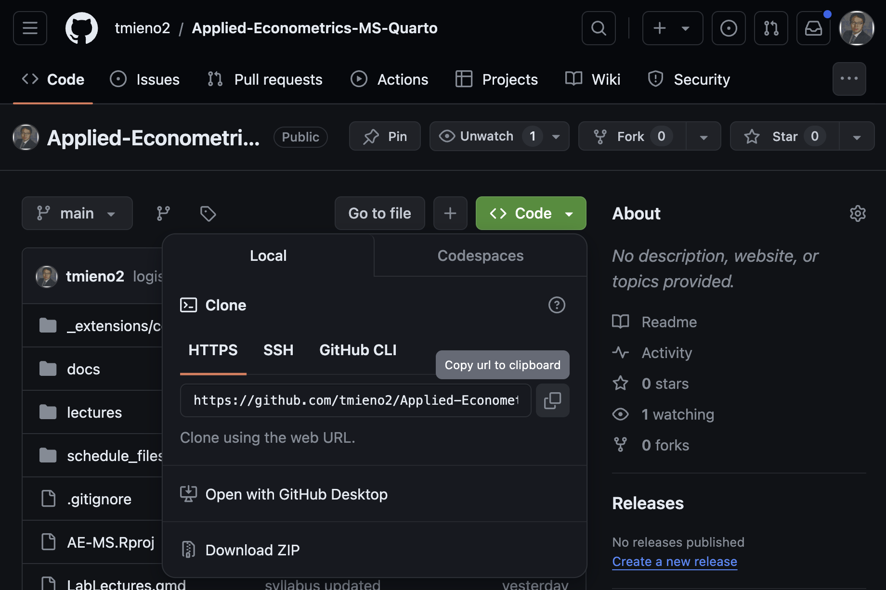
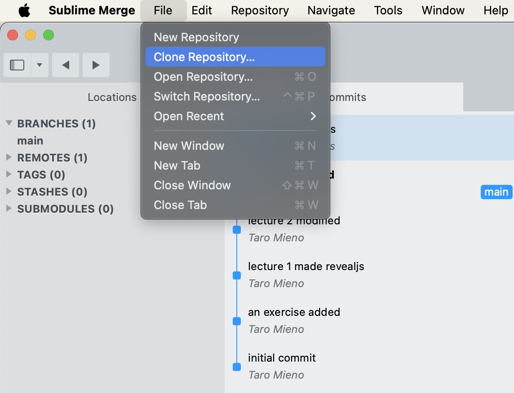
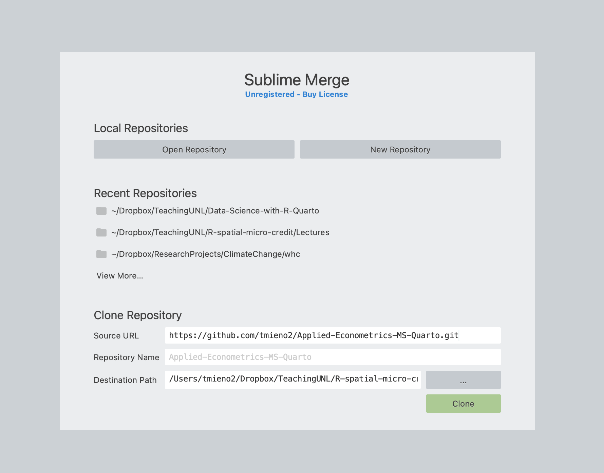

# How this lecture works

<html><div style='float:left'></div><hr color='#EB811B' size=1px width=796px></html>

## What you will and will not learn today

::: {.panel-tabset}

### The plan

Much of what you will use in this course, and in research, is shared on **GitHub**: datasets, example projects, other people's code. This short lecture is about one thing: getting a copy of such a project onto your computer, and knowing where it went.

An AI assistant can run the command that makes the copy. What it cannot do is:

+ know which project you need
+ know where on your computer you want it, and where you will look for it later
+ tell whether the copy is complete

So today is about:

1. **The concept**: what a repository is, and what cloning one does
2. **Reading code**: recognising the one command that clones
3. **Asking AI**: what to tell an agent so it clones to the right place
4. **Checking**: how to tell that the copy is there and complete

### What this lecture leaves out

GitHub is built on **git**, a program that records the history of a project. Recording your own changes, sending them back to GitHub and working with others on the same project are taught in Chapter 6 (lecture 06-2). You do not need any of that today: here, files only come **down** from GitHub to you.

### Directions

+ Install [Sublime Merge](https://www.sublimemerge.com/), a free-to-try program that can clone with three clicks. RStudio can also clone (**File, New Project, Version Control, Git**, then paste the URL), if git is installed on your computer; so can any other git program you already know.
+ Sublime Merge may be evaluated without a time limit, but asks now and then for a license. That window does not mean anything has expired; everything in this course works during the evaluation.

:::

# The concept

<html><div style='float:left'></div><hr color='#EB811B' size=1px width=796px></html>

## Repositories and cloning

::: {.panel-tabset}

### Repository

A **repository** is a project folder kept by git: the files, plus a record of every change made to them. **GitHub** is a website that stores repositories online.

+ A **public** repository can be seen and copied by anyone.
+ A **private** one only by its owner and the people they invite.

Every repository has an address, its **URL**, for example `https://github.com/tmieno2/data-science-course-supplementary-datasets`, which holds the datasets used in Chapter 3.

### Clone

**Cloning** makes a copy of a repository on your computer: a new folder with all the files in it, named after the repository by default.

The copy remembers where it came from. When the owner changes the files on GitHub, you can bring the changes into your copy instead of copying everything again (called **pulling**; Chapter 6).

### Clone or download?

GitHub also offers **Download ZIP**, which gives you the files once.

| | Clone | Download ZIP |
|---|---|---|
| You get the files | yes | yes |
| The copy knows where it came from | yes (a hidden `.git` folder inside it) | no |
| You can bring in later changes | yes | no; download again |
| Needs a git program | yes | no |

For a course whose files are updated during the term, clone. For a file you need once, a download is fine.

:::

## What has to be true for a clone to work

1. **The URL is right.** It is the address of the repository, not of a single file in it.
2. **You can see the repository.** Public: anyone can. Private: you must be invited and signed in.
3. **The destination is free.** The new folder's name is not already taken in the folder you clone into.
4. **You know where the copy went.** Otherwise you cannot find it again, and you may end up with several copies.

:::{.callout-important}
Conditions 1 to 3 fail with an error message. Condition 4 fails silently: the clone works, and the folder sits somewhere you never look. That is the mistake to guard against.
:::

# Cloning

<html><div style='float:left'></div><hr color='#EB811B' size=1px width=796px></html>

## With Sublime Merge

::: {.panel-tabset}

### 1. Copy the URL

On the repository's page on GitHub, click the green **Code** button, keep **Local** and **HTTPS** selected, and click the copy button next to the address (two overlapping squares).

{width=60% fig-alt="The GitHub Code button opened, showing the repository's HTTPS address and the copy button next to it"}

### 2. Clone

In Sublime Merge: **File, Clone Repository**.

{width=55% fig-alt="The Sublime Merge File menu with Clone Repository selected"}

### 3. Choose where

{width=45% fig-alt="The Sublime Merge clone dialog, with boxes for the Source URL, the Repository Name and the Destination Path"}

+ **Source URL**: the address you copied (paste it if the box is empty)
+ **Repository Name**: the name the new folder will have. Leave it as it is unless you have a reason.
+ **Destination Path**: the folder the new folder goes **into**. Choose it on purpose (the gray `...` button), for example a `courses` folder you keep all course material in.
+ Click **Clone**.

:::

## With an AI agent

::: {.panel-tabset}

### How clone commands are written

An agent in your editor or terminal clones with one command. Whatever the program around it, the command follows this pattern:

```{verbatim}
git clone <URL> <folder>
```

| Part | What it is | Required? |
|---|---|---|
| `git clone` | The git program, asked to clone | Yes |
| `<URL>` | The repository's address | **Yes** |
| `<folder>` | The name of the new folder | No; the default is the repository's name |

The command makes the new folder **inside the folder the terminal is in at that moment**. So the agent usually moves there first:

```{verbatim}
cd ~/courses
git clone https://github.com/tmieno2/data-science-course-supplementary-datasets.git
```

`cd` (change directory) moves the terminal into a folder; `~` is your home folder. The `.git` at the end of the URL is optional.

### Variations you will see

+ RStudio: **File, New Project, Version Control, Git**, then paste the URL. It runs the same `git clone`, and makes the copy an R Project.
+ `gh repo clone tmieno2/data-science-course-supplementary-datasets`: GitHub's own command-line program, same result.
+ If the agent says git is not installed, it can tell you how to install it for your system; or use Sublime Merge, which brings its own.

:::

## What the AI cannot know

The agent knows the command. Your request supplies:

1. **Which repository**: its URL, copied from GitHub, not typed from memory
2. **Where the copy goes**: the full path of the folder it should go **into**
3. **What to report back**: the full path of the new folder and what is in it, so you can check

```text
Clone the repository <URL copied from the GitHub page> into the folder
<full path of the folder it should go into>. Do not change any
file in it. When done, tell me the full path of the new folder and list
the files at its top level.
```

This request asks the agent to run a command once, not to write analysis code, so it does not end with the closing instructions used for code (lecture 02-1).

# Checking the result

<html><div style='float:left'></div><hr color='#EB811B' size=1px width=796px></html>

## Is the copy there, and complete?

::: {.panel-tabset}

### The checks

| | Check | How | Expected |
|---|---|---|---|
| 1 | The folder is where you chose | Open the destination folder in Finder (Mac) or File Explorer (Windows) | A new folder named after the repository |
| 2 | It holds the same files as on GitHub | Compare its top level with the file list on the GitHub page | The same names |
| 3 | It is a clone, not a download | Show hidden files (Mac Finder: Cmd + Shift + period; Windows: View, Show, Hidden items) and look inside | A `.git` folder |
| 4 | You will find it again | Write its full path down, for example in a note | |

For the datasets repository, the GitHub page lists the files to expect: the `corn_yields` files in several formats and a `readme.md`.

### When it fails

| Message | What it means |
|---|---|
| `Repository not found` | The URL is wrong, or the repository is private and you are not signed in or not invited |
| `destination path '...' already exists and is not an empty directory` | You cloned it before into the same folder. Use that copy, or choose another destination |
| A message that git is not found or not recognized, or a window offering to install command line tools (Mac) | Git is not installed. Use Sublime Merge, or ask the AI how to install git on your system |

If Sublime Merge opened the repository but you cannot find the folder: with the repository open, choose **Repository, Open Containing Folder**.

:::

# Summary

<html><div style='float:left'></div><hr color='#EB811B' size=1px width=796px></html>

## What you must understand, and what the AI can do

| You need to understand | The AI or Sublime Merge can do |
|---|---|
| A repository is a project folder kept by git; GitHub stores it online | |
| Cloning copies it to your computer and keeps the link back, so later changes can be pulled; a ZIP download does not | |
| Which repository you need, and its URL | The `git clone` command |
| Where the copy should go, chosen on purpose | Moving the terminal to that folder |
| That the copy is there, complete, and written down | Listing the files |

Recording, sending and sharing your own changes is Chapter 6.
