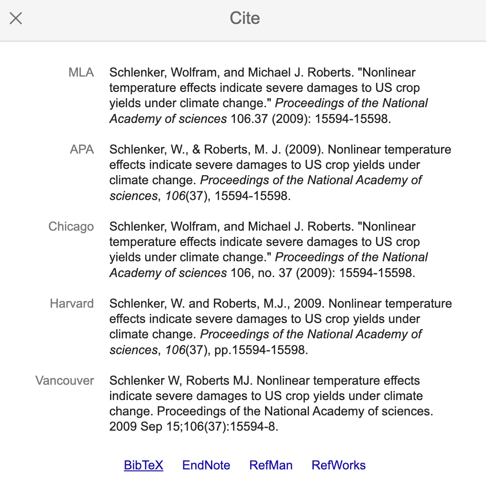

```{r}
#| label: setup
#| include: false
library(ggplot2)
library(dplyr)
source(here::here("lectures/_lecture-theme.R"))
theme_set(lecture_theme())

# An example table for the figure and table slides: yields of one farm, made
# up for illustration
harvest <- data.frame(
  year = 2015:2024,
  yield = c(181, 188, 176, 192, 185, 196, 171, 199, 194, 203),
  drought = c(FALSE, FALSE, TRUE, FALSE, FALSE, FALSE, TRUE, FALSE, FALSE, FALSE)
)
```

# How this lecture works

<html><div style='float:left'></div><hr color='#EB811B' size=1px width=796px></html>

## What you will and will not learn today

::: {.panel-tabset}

### The plan

A thesis chapter or a journal article can be written as a Quarto document: the text, the code that makes every figure and table, and the references, in one file that renders to Word, PDF or HTML. Every number and figure then comes from the data at each render, and the reference list is built from what you cite.

An AI assistant can set all of this up and write every line of it. What it cannot do is:

+ know which journal or committee the article is for, and the format and style they require
+ decide what each figure and table must show, and which claim in the text it supports
+ know whether a reference it writes down **exists**, and says what you cite it for

So today is about:

1. **The concept**: what an article needs that a report does not
2. **Reading code**: recognising how figures, tables, equations and citations are numbered and referred to
3. **Asking AI**: what to put in requests for an article, and what never to ask it to supply
4. **Checking**: the mistakes that render without an error, and how to find them

### Directions

+ Lecture 02-1 (Quarto documents and rendering) comes first; this lecture assumes it.
+ Rendering to Word needs nothing extra. Rendering to PDF needs a LaTeX installation; if the PDF render fails, ask the AI how to install TinyTeX for Quarto (`quarto install tinytex`).

:::

# The concept

<html><div style='float:left'></div><hr color='#EB811B' size=1px width=796px></html>

## What an article needs that a report does not

| | Report (lecture 02-1) | Article |
|---|---|---|
| Reader | Advisor, coauthor: checks the work | Referee, journal reader: follows the argument |
| Code | Shown or folded | Hidden; the code stays in the `.qmd` |
| Figures and tables | Under the chunk that makes them | **Numbered**, with captions, and referred to by number ("Figure 2 shows") |
| Claims from others' work | Rare | **Cited**, with a reference list in the journal's style |
| Format | HTML | What the journal asks for: usually Word or PDF |

The last three rows are what this lecture is about. All three can go wrong **without an error**: a reference to a figure that does not resolve, a citation to a key that is not in your reference file, a reference that does not exist. The render finishes; only reading the output finds them.

## The decisions that come before writing

1. **Where it goes**: the journal or committee decides the output format (Word or PDF), the citation style, and often the length and the number of figures. Read their instructions for authors first.
2. **The claims and their evidence**: for each claim in the results, which figure or table supports it. A figure no sentence refers to is a figure the reader does not need.
3. **What you cite, and why**: each citation supports a specific sentence. You must have read, at least, the part you cite it for.
4. **Where references come from**: a reference file you built from the publishers' own records (see "Citations"), never from the AI's memory.

# How an article is written

<html><div style='float:left'></div><hr color='#EB811B' size=1px width=796px></html>

## Numbered figures, tables and equations

Figures, tables and equations all follow the same pattern: give the item a label with the right prefix and a caption, then refer to the label in the text.

::: {.panel-tabset}

### The pattern

| Item | Label must start with | Caption | In the text, write | The reader sees |
|---|---|---|---|---|
| Figure from a chunk | `fig-` | `#| fig-cap: "..."` | `@fig-yield` | Figure 1 |
| Table from a chunk | `tbl-` | `#| tbl-cap: "..."` | `@tbl-summary` | Table 1 |
| Equation | `eq-` | none | `@eq-trend` | Equation 1 |

Numbers are given in order of appearance and change by themselves when items are added or moved. The word "Figure" is added for you: write `@fig-yield`, not `Figure @fig-yield`, which gives "Figure Figure 1".

### A figure

`````{verbatim}
```{r}
#| label: fig-harvest
#| fig-cap: "Yield on the farm, 2015 to 2024. Drought years in orange."
ggplot(harvest, aes(x = year, y = yield, colour = drought)) + ...
```

Yields rose over the decade, except in drought years (@fig-harvest).
`````

Rendered:

```{r}
#| label: fig-harvest
#| fig-cap: "Yield on the farm, 2015 to 2024. Drought years in orange."
#| echo: false
#| fig-height: 4.5
ggplot(harvest, aes(x = year, y = yield, colour = drought)) +
  geom_point(size = 3) +
  scale_colour_manual(values = c(`FALSE` = "#0072B2", `TRUE` = "#E69F00"), guide = "none") +
  scale_x_continuous(breaks = seq(2015, 2024, by = 3)) +
  labs(x = NULL, y = "Yield (bushels per acre)")
```

Yields rose over the decade, except in drought years (@fig-harvest).

### A table

`````{verbatim}
```{r}
#| label: tbl-drought
#| tbl-cap: "Average yield in drought and other years."
harvest |> group_by(drought) |> summarise(years = n(), yield = mean(yield))
```

Drought years averaged far less than other years (@tbl-drought).
`````

Rendered:

```{r}
#| label: tbl-drought
#| tbl-cap: "Average yield in drought and other years."
#| echo: false
harvest |>
  group_by(drought) |>
  summarise(years = n(), average_yield = round(mean(yield), 1)) |>
  knitr::kable()
```

Drought years averaged far less than other years (@tbl-drought).

### An equation

Math is written between dollar signs, in the notation of LaTeX (the typesetting system most journals use): `$\beta$` inside a sentence, `$$ ... $$` on its own line. A label after the closing `$$` numbers it:

`````{verbatim}
$$
y_t = \alpha + \beta t + \varepsilon_t
$$ {#eq-trend}

The trend $\beta$ in @eq-trend is estimated by least squares.
`````

Rendered:

$$
y_t = \alpha + \beta t + \varepsilon_t
$$ {#eq-trend}

The trend $\beta$ in @eq-trend is estimated by least squares.

### When it goes wrong

A reference to a label that does not exist, or whose prefix is wrong, does **not** stop the render. Quarto prints a warning in the render log and puts the label, with a question mark, into the text:

```{verbatim}
See ?@fig-two for the trend.
```

This happens when the chunk was labelled `plot-two` instead of `fig-two`, when a label contains `_` where the text has `-`, or when the AI renamed a chunk and not the reference. Search every output for `?@` before you send it.

:::

## Citations

::: {.panel-tabset}

### The pattern

References live in a **bibliography file**, usually ending in `.bib`. The header names it, and the text cites entries by their **key**, the first word of each entry:

`````{verbatim}
---
bibliography: references.bib
csl: american-journal-of-agricultural-economics.csl
---

The figures were made with ggplot2 [@wickham2016].
@wickham2016 describes the system behind them.
`````

| You write | The reader sees |
|---|---|
| `[@wickham2016]` | (Wickham 2016) |
| `@wickham2016` | Wickham (2016), as part of the sentence |
| `[@wickham2016; @rcore2025]` | two works in one bracket |

The reference list is built from what you cite, in the style the `csl` file names (a **CSL** file holds one journal's citation style; thousands are free at [zotero.org/styles](https://www.zotero.org/styles)). Change that one line, and every citation and the list are restyled. Entries in the `.bib` file that you never cite are left out.

### An entry

````{verbatim}
@book{wickham2016,
  title     = {ggplot2: Elegant Graphics for Data Analysis},
  author    = {Wickham, Hadley},
  publisher = {Springer International Publishing},
  year      = {2016},
  doi       = {10.1007/978-3-319-24277-4}
}
````

| Part | What it is |
|---|---|
| `@book` | The kind of work: `@article`, `@book`, `@manual`, ... |
| `wickham2016` | The key, used in `[@...]` |
| `doi` | The **DOI** (digital object identifier): a permanent address. `https://doi.org/` followed by the DOI opens the work at its publisher. |

### Where entries come from

Get each entry from a record you looked up, never typed by anyone:

+ The article's page at the journal: "Cite" or "Export citation", choose BibTeX
+ Google Scholar: the quotation-mark icon under the result, then **BibTeX**:

{width=35% fig-alt="Google Scholar's Cite window, with citation formats and a BibTeX link at the bottom"}

  Google Scholar's entries usually have no DOI and sometimes have errors; compare them with the publisher's page.

+ From a DOI: RStudio's visual editor (**Insert, Citation**, then paste the DOI) writes the entry into your `.bib` file
+ For R and its packages: `citation()` and `citation("ggplot2")` print the entry the authors want you to use

### Rendered

The citation [@wickham2016] and the in-text form @rcore2025 on this slide come from `02-4-example.bib`, beside this deck. The reference list is on the last slide.

:::

## The reference that does not exist

::: {.panel-tabset}

### What happens

Asked to "add references" or "find a citation for this sentence", an AI often writes a `.bib` entry from memory. Some of what it writes is a real work. Some is not: a plausible title, real-sounding authors, a real journal, a DOI. It looks exactly like the real ones, and it renders exactly like them.

This entry is in the `.bib` file beside this deck:

```{verbatim}
@article{miller2019,
  title   = {Irrigation Scheduling and Corn Yield Stability in the Great Plains},
  author  = {Miller, Jonathan and Park, Soo-Jin},
  journal = {American Journal of Agricultural Economics},
  volume  = {101},
  number  = {4},
  pages   = {1102--1121},
  year    = {2019},
  doi     = {10.1093/ajae/aaz999}
}
```

Cited, it renders without a warning: @miller2019. It is invented for this slide. The article does not exist, and `https://doi.org/10.1093/ajae/aaz999` returns "DOI not found".

### The check

For **every** entry in the reference list, before anything is sent:

1. Open `https://doi.org/` followed by its DOI.
2. Check that the page that opens has the **same title, the same authors and the same year** as the entry.
3. Check that the work says what the sentence citing it claims.

A DOI that does not open is one failure. A DOI that opens a **different** work is the other, and it is easy to miss if you check only that the link works.

An entry with no DOI (a book, a report, R itself) is checked by finding it at its publisher or in a library catalogue.

:::{.callout-important}
A reference you cannot open and check does not go into the article. Citing a work that does not exist is a serious error in a thesis or a journal submission, whoever wrote the entry.
:::

:::

## The header of an article

::: {.panel-tabset}

### The pattern

`````{verbatim}
---
title: "Drought and the Trend in Corn Yields"
author:
  - name: Your Name
    affiliations:
      - name: University of Nebraska-Lincoln
abstract: |
  Two or three sentences, which may run over several lines
  because of the | above.
bibliography: references.bib
csl: american-journal-of-agricultural-economics.csl
format:
  docx:
    echo: false
  pdf:
    echo: false
  html:
    echo: true
    embed-resources: true
---
`````

| Setting | What it does |
|---|---|
| `author:` with `- name:` | A list of authors, each with their own affiliations |
| `abstract: |` | The abstract, set apart from the text |
| `bibliography`, `csl` | The reference file and the citation style |
| `format:` with several entries | One `.qmd`, several outputs: Word (`docx`), PDF, HTML. In RStudio the Render button gets a menu to choose. |
| `echo: false` under `docx` and `pdf`, `echo: true` under `html` | No code in the article; the code shown in the HTML version you use for checking |

### Which format

| Format | Choose it when |
|---|---|
| Word (`docx`) | The journal or a coauthor asks for Word; coauthors edit in Word with tracked changes |
| PDF (`pdf`) | The journal asks for a PDF, or a LaTeX source |
| HTML | For you and your advisor while writing: fastest to render and read |

The journal's instructions decide. A Word file edited by a coauthor is no longer rendered from your `.qmd`: their edits must be copied back into the `.qmd` by hand, or the next render loses them.

:::

# Asking AI

<html><div style='float:left'></div><hr color='#EB811B' size=1px width=796px></html>

## The same way of working, for an article

The way of working with AI from lecture 02-1 applies to every chunk of an article: the AI writes into the `.qmd`, with one plain-English sentence above each chunk, and you render and judge the output. Two things differ:

+ **With the code hidden, the sentences above the chunks are for you.** Ask for each as a comment on the chunk's first line (a line starting with `#`). It then shows with the code in the HTML version, where the code is shown for checking, and stays out of the Word or PDF version.
+ **The AI never supplies references.** It may format, sort and insert entries **you** give it. It may suggest what to search for. It does not write a `.bib` entry from memory.

:::{.callout-note}
Every request for code still ends with the **closing instructions**; the full text is under **Recommended requests** near the end.
:::

## What to put in your request

1. **The target**: journal or committee, output format, citation style (the `.csl` file)
2. **For each figure or table**: what it must show, the claim in the text it supports, the label (`fig-...`, `tbl-...`) and the caption
3. **The text that refers to it**: by `@` label, never "the figure below" (in a PDF, the figure may land on the next page)
4. **Numbers in sentences**: as inline R
5. **Citations**: only keys that are already in your `.bib` file, and a list of any sentence that seems to need a citation you have not provided
6. **The checks**, and **the closing instructions**

## A weak request and a strong one

::: {.panel-tabset}

### Weak

```text
Write the results section of my paper with a figure and some citations.
```

The AI decides what the figure shows, writes text you did not decide, and invents the citations, complete with DOIs.

### Strong

An example for one figure and one sentence:

```text
In my article paper/article.qmd, add a figure of yield by year for the
farm, with drought years in a different colour, labelled fig-harvest,
with the caption "Yield on the farm, 2015 to 2024. Drought years in
orange." It supports the sentence "Yields rose over the decade, except
in drought years", which you add right after it, referring to the
figure with @fig-harvest. Cite only keys already in references.bib;
add no entries to it. If a sentence seems to need a citation I have
not given, list it for me instead. Check the number of years (I expect
10). Write the sentence for each chunk as a comment on the chunk's
first line, starting with #, so it shows with the code in the HTML
version and stays out of the Word version.

Put the code in my Quarto document paper/article.qmd, under the
heading "Results", as R code chunks. Above each chunk, write one
plain-English sentence saying what it does and why. Build every path
with here::here(); no setwd(), no absolute paths. Print each check on
its own line as "name of check: expected X, got Y". Render the document
to HTML.
```

In an article, the check lines would appear in the text. Render the HTML version to check, then hide them in the version you send (for example with `include: false` on the check chunk, the one place where hiding a chunk is right: it changes nothing).

:::

# Checking the result

<html><div style='float:left'></div><hr color='#EB811B' size=1px width=796px></html>

## The mistakes that render without an error

::: {.panel-tabset}

### The checks

| | Check | How | Why |
|---|---|---|---|
| 1 | No unresolved reference | Search the output for `?@`, and the render log for "Unable to resolve" | A broken reference renders as text, with no error |
| 2 | No unknown citation key | Search the output for `?)` and the log for "citation ... not found" | A key not in the `.bib` renders as "(key?)" |
| 3 | Every reference exists | Open every DOI; compare title, authors, year | Invented entries render like real ones |
| 4 | Every citation supports its sentence | Read what you cite | Only you can say what a work shows |
| 5 | Every figure and table is referred to, and says what its sentence claims | Read each sentence next to its figure | A figure no sentence uses, or one that shows something else, misleads the referee |
| 6 | Every number in the text is computed | Open the `.qmd`: inline R, not typed | The article will be revised many times |
| 7 | It renders in the required format | Render to Word or PDF, open it, read it | Each format can fail on its own |

### What checks 1 and 2 look like

A chunk labelled `plot-two` but referred to as `@fig-two`, and a citation to a key that is not in the `.bib` file, render as:

> See ?\@fig-two. As shown by (smith2020?).

with no error. The render log says, among other lines:

```text
WARNING ... Unable to resolve crossref @fig-two
[WARNING] Citeproc: citation smith2020 not found
```

:::

# Recommended requests

<html><div style='float:left'></div><hr color='#EB811B' size=1px width=796px></html>

## Requests you can copy

Copy one, then replace every `<...>` with what only **you** know: the target, the claims, the sources. Every request for code ends with the closing instructions.

::: {.panel-tabset}

### Closing instructions

The lines that end every request for code. Replace the two blanks; leave "expected X, got Y" as it is, because it tells the AI how to print each check:

```text
Put the code in my Quarto document <path to your .qmd>, under the
heading "<heading>", as R code chunks. Above each chunk, write one
plain-English sentence saying what it does and why. Build every path
with here::here(); no setwd(), no absolute paths. Print each check on
its own line as "name of check: expected X, got Y". Render the document
to HTML.
```

A chat assistant cannot render: paste its chunks into your `.qmd` and render it yourself. An agent in your editor or terminal can do every step.

### Set up an article

```text
Create a Quarto article at <path to the new .qmd> for <journal or
committee>. Title "<title>"; authors <names and affiliations>; an
abstract I will write. Outputs: <docx, pdf, html>. References from
<path to your .bib file>, in the style of <path to the .csl file>. No
code in the output. Headings, empty for now: <headings, in order>.

Put the code in my Quarto document <path to your .qmd>, under the
heading "<heading>", as R code chunks. Above each chunk, write one
plain-English sentence saying what it does and why. Build every path
with here::here(); no setwd(), no absolute paths. Print each check on
its own line as "name of check: expected X, got Y". Render the document
to HTML.
```

### Add a figure or table

```text
Add a <figure or table> of <what it shows>, labelled <fig- or tbl-
label>, with the caption "<caption>". It supports the sentence
"<the claim>", which you add right after it, referring to it with
@<label>. Check <a check you know the answer to>. Write the sentence
for each chunk as a comment on the chunk's first line, starting with #,
so it shows with the code in the HTML version and stays out of the Word
version.

Put the code in my Quarto document <path to your .qmd>, under the
heading "<heading>", as R code chunks. Above each chunk, write one
plain-English sentence saying what it does and why. Build every path
with here::here(); no setwd(), no absolute paths. Print each check on
its own line as "name of check: expected X, got Y". Render the document
to HTML.
```

### Cite from my file

This and the next request ask the AI for text, not code, so they do not end with the closing instructions. Render the document yourself afterwards and search it for `?)`.

```text
In <path to your .qmd>, cite <key> for the sentence "<the sentence>".
Cite only keys already in <path to your .bib file>; add no entries to
it. If any other sentence seems to need a citation, list it for me
instead of adding one. Then render the document to HTML.
```

### List the references to check

```text
From <path to your .bib file>, list every entry cited in <path to your
.qmd>, one per line: key, authors, year, title, and the full address
https://doi.org/<DOI>. Mark any entry without a DOI. Do not correct or
complete any entry; I will check each one myself.
```

:::

## References

Miller and Park (2019) is the invented entry from the slide "The reference that does not exist". It is listed here exactly as a real one would be.

::: {#refs}
:::

# Summary

<html><div style='float:left'></div><hr color='#EB811B' size=1px width=796px></html>

## What you must decide, and what the AI can write

| You need to decide or understand | The AI can write |
|---|---|
| The target journal or committee, its format and style | The header, the `.csl` line |
| Which claim each figure and table supports | The chunks, labels and captions |
| That references to figures, tables and equations go by label, and that a broken one renders as `?@` | The `@` references |
| Where each reference comes from, that it exists, and what it shows | Citations to keys **you** put in the `.bib` |
| That a render without errors can still hold all of these mistakes | |

**Every article:** decide the target, the claims and the sources before asking. Never let the AI write a reference. Render, search the output for `?@` and `?)`, open every DOI, and read each figure and table next to the sentence that cites it.
