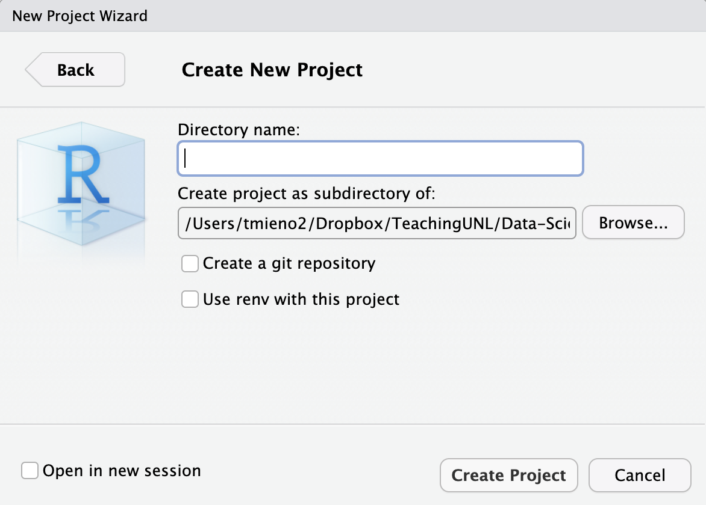
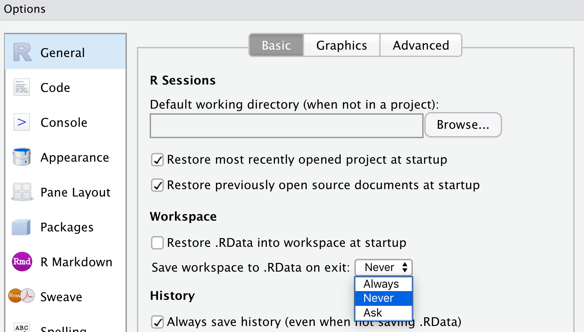

```{r}
#| label: setup
#| include: false
library(readr)
library(dplyr)

# A small example project, built in a temporary folder every time these slides
# are rendered, so that every output shown on them is real.
proj <- file.path(tempdir(), "corn-project")
unlink(proj, recursive = TRUE)
for (d in c("data/raw", "data/processed", "analysis", "results")) {
  dir.create(file.path(proj, d), recursive = TRUE)
}
writeLines("Version: 1.0", file.path(proj, "corn-project.Rproj"))
file.copy("corn_yields.csv", file.path(proj, "data", "raw"))

step_clean <- c(
  "---", "title: \"Clean the corn data\"", "---", "",
  "## Clean", "",
  "Read the raw yields and keep only the irrigated fields, since the analysis is about irrigated corn.", "",
  "```{r}",
  "library(readr)",
  "library(dplyr)",
  "corn <- read_csv(here::here(\"data\", \"raw\", \"corn_yields.csv\"), show_col_types = FALSE)",
  "irrigated <- filter(corn, Irrigated == 1)",
  "```", "",
  "Save the cleaned table for the next step.", "",
  "```{r}",
  "saveRDS(irrigated, here::here(\"data\", \"processed\", \"irrigated.rds\"))",
  "```", "",
  "Check the number of rows against the count of irrigated rows in the raw file.", "",
  "```{r}",
  "cat(\"irrigated rows: expected 74, got\", nrow(irrigated), \"\\n\")",
  "```"
)
writeLines(step_clean, file.path(proj, "analysis", "01-clean.qmd"))

step_summary <- c(
  "---", "title: \"Average irrigated yield\"", "---", "",
  "Read the cleaned table that step 01 saved.", "",
  "```{r}",
  "irrigated <- readRDS(here::here(\"data\", \"processed\", \"irrigated.rds\"))",
  "```", "",
  "Compute the average yield and save it as a small table for the paper.", "",
  "```{r}",
  "avg <- data.frame(mean_yield = mean(irrigated$Yield))",
  "write.csv(avg, here::here(\"results\", \"mean-yield.csv\"), row.names = FALSE)",
  "```"
)
writeLines(step_summary, file.path(proj, "analysis", "02-summary.qmd"))

# Render one step in its own R session, as `quarto render` from a terminal does.
render_step <- function(file) {
  out <- suppressWarnings(system2(
    "quarto", c("render", shQuote(file)),
    stdout = TRUE, stderr = TRUE
  ))
  status <- attr(out, "status")
  list(ok = is.null(status) || status == 0, output = gsub("\033\\[[0-9;]*m", "", out))
}

list_outputs <- function() {
  c(
    list.files(file.path(proj, "data", "processed")),
    list.files(file.path(proj, "results"))
  )
}
```

# How this lecture works

<html><div style='float:left'></div><hr color='#EB811B' size=1px width=796px></html>

## What you will and will not learn today

::: {.panel-tabset}

### The plan

A research project runs for months or years and has many pieces: data files, code, figures, tables, the paper. An AI assistant can write any single piece of code in it. What it cannot do is:

+ see how your project folder is laid out
+ know which files you received and which your code made
+ know which step a piece of code belongs to, or what has to run before it
+ tell whether the whole project still rebuilds from the start

Those four are your job. So today is about:

1. **The concept**: what a reproducible project is, and what has to be true of its folder and its code
2. **Reading code**: recognising how a step of a project reads and writes files, without memorising it
3. **Asking AI**: what to tell the AI about your project
4. **Checking**: how to tell whether your project still rebuilds, and whether the AI broke a rule of it

### Directions

+ Ask your AI assistant to install the `here` and `quarto` packages if you have not already.
+ Lecture 03-1 introduced paths and `here::here()` for reading one file. This lecture builds on its slide "Condition 1: R can find the file".
+ The examples on these slides use a small project that is built in a temporary folder each time the slides are made, from `corn_yields.csv` (the corn data from 03-1). Every output shown is real. In the code that runs these examples, paths start from `proj`, the temporary project's folder, instead of `here::here()`, and `render_step()` is a small function written for these slides that renders one `.qmd` in its own R session, as `quarto render` in a terminal does, and reports whether it worked.

:::

# The concept

<html><div style='float:left'></div><hr color='#EB811B' size=1px width=796px></html>

## What a project has to do

::: {.panel-tabset}

### Reproducible

A research project is **reproducible** if anyone, including you a year from now, can produce exactly the same results from the same data by following what the project records.

The minimum requirement: every action taken on the data is recorded, so nobody has to guess a step. An action you took and did not record (deleting rows in Excel, renaming a column by hand, running a line at the Console and not saving it) is called a **hidden action** on these slides. A project with a hidden action is not reproducible, however tidy it looks.

:::{.callout-note}
Reproducible is not the same as **replicable** (another team reaches the same conclusion with different data). This lecture is about reproducible only.
:::

### The test

A project passes one test, and you can run it yourself:

1. Delete every file your code made.
2. Start a fresh R session.
3. Run the code, in order, from the raw data.
4. Everything comes back, and the numbers are the same.

If a step fails, it depended on something that was never recorded: a file made by hand, an object left in R's memory, a step you ran once and forgot. Each of those is invisible until you delete the outputs and try.

### Who it is for

+ **You, later.** You will need to rerun the analysis with one change, months after you last opened it, for a revision or a referee.
+ **Your advisor and coauthors.** They can check a result by following the project, without asking you how it was made.
+ **Readers of the paper.** Many journals now ask for the code and data, and check that they run.

:::

## How a project folder is laid out

Most research projects need the same few places. Folder names vary; what each one holds does not.

::: {.panel-tabset}

### The pattern

```text
my-project/
  my-project.Rproj    marks the project root
  README.md           what the project is, and what to run in what order
  data/
    raw/              files exactly as you received them
    processed/        files your code made from them
  analysis/
    01-clean.qmd      one step per document, numbered in run order
    02-merge.qmd
    03-regression.qmd
  results/            figures and tables your code saved
  writing/            the paper or report
```

| Part | What it holds | Required? |
|---|---|---|
| `.Rproj` file | Marks the top of the project (the **project root**). `here::here()` builds every path from it. | **Yes** |
| `data/raw/` | Data as you received it. Your code reads it and never writes to it. | **Yes**, if you have data |
| `data/processed/` | Tables your code made. Can be deleted and rebuilt at any time. | Yes, once any step saves a table |
| `analysis/` | The code, one `.qmd` per step | **Yes** |
| `results/` | Figures and tables for the paper. Can be deleted and rebuilt. | Once you save any |
| `README.md` | A short text file saying what the project is and how to rerun it | Strongly recommended |
| `writing/` | The paper, if you write it in the project | No |

### Variations you will see

AI assistants and other people's projects use other names for the same places. They change how the folder looks, not what it does:

+ `Code/`, `R/`, `scripts/` or `src/` for `analysis/`
+ `Data/Raw/` and `Data/Processed/`, `data-raw/` and `data/`, or `input/` and `output/` for the two kinds of data
+ `output/`, `figures/` or `tables/` for `results/`
+ steps written as `.R` scripts instead of `.qmd` documents

What to look for in any of them: one place for data you received, a separate place for data the code made, and code whose names tell you the order.

### The smallest version

Lecture 03-1 used the smallest version of this pattern: a project with `data/` and `analysis/`. That is enough while your code only reads files.

Split `data/` into `raw/` and `processed/` as soon as any step saves a table. From then on, a file's folder tells you whether you can delete it.

### Making the project

An **R Project** is a folder with a `.Rproj` file in it. In RStudio: File, New Project, New Directory, New Project. RStudio writes the `.Rproj` file and opens a fresh R session in that folder.

:::{.callout-important}
`here` recognises a `.Rproj` file only if its first line starts with `Version:`. Every `.Rproj` that RStudio creates has that line. An empty file named `something.Rproj`, made any other way, does not count, and `here::here()` then points at the wrong folder.
:::

### The New Project window

{width=55% fig-alt="RStudio's Create New Project window, with a box for the directory name, a box for the parent folder, and two tick boxes, Create a git repository and Use renv with this project"}

:::

## What has to be true for a project to rebuild

::: {.panel-tabset}

### The four conditions

1. **Every path starts from the project root.** No path depends on whose computer it is or which folder R happens to be in.
2. **Raw data is never changed.** Every change to the data is code that reads from `data/raw/` and writes somewhere else.
3. **Each step reads files and writes files.** No step depends on objects that another step, or the Console, left in R's memory.
4. **The order is written down.** Anyone can tell which step runs first.

### Failures with and without an error

+ If condition 1 fails, the project stops with an **error** on the next computer: the file is not found.
+ If condition 2, 3 or 4 fails, the project usually still **runs today, on your computer, with no error**. It fails later: when someone else runs it, when you restart R, or never visibly, because the raw file you would compare against has been overwritten.

:::{.callout-important}
Like the silent failures in 03-1, these are why checking matters. A project that runs is not the same as a project that rebuilds.
:::

:::

## Condition 1: every path starts from the project root

::: {.panel-tabset}

### The rule

In 03-1, Condition 1 was about one file. In a project, every step reads from one folder and writes to another, so every path in every step is built the same way:

```{r}
#| eval: false
here::here("folder", "subfolder", "file name")
```

| Part | What it is |
|---|---|
| `here::here(` | Finds the project root by looking for the `.Rproj` file, starting from wherever R is |
| `"folder", "subfolder"` | The folders below the root, one piece each, in order |
| `"file name"` | The file, last |

The result is the full path, correct on any computer that has the project.

### Why it matters more in a project

A `.qmd` file runs with its own folder as the working directory (the folder R is in, see 03-1). Every step lives in `analysis/`, so a typed path such as `"data/raw/corn_yields.csv"` is looked for in `analysis/data/raw/`, which does not exist.

| Written as | At the Console of the project | When `analysis/01-clean.qmd` is rendered |
|---|---|---|
| `"data/raw/corn_yields.csv"` | works | **fails**: no such file |
| `"../data/raw/corn_yields.csv"` | **fails** | works |
| `here::here("data", "raw", "corn_yields.csv")` | works | works |

`..` means "the folder above". It works in one place and not the other, which is why `here::here()` is the one to use.

### What else breaks it

+ `setwd("C:/Users/yourname/...")`: changes the working directory to a folder that exists only on one computer.
+ An absolute path such as `"/Users/yourname/Desktop/corn.csv"`: the same problem, without `setwd()`.
+ A file kept outside the project folder, such as in Downloads: no path from the root reaches it. Copy it into `data/raw/`.

:::

## Condition 2: raw data is never changed

::: {.panel-tabset}

### Raw and processed

**Raw data** is a file as you received it: downloaded, sent by a coauthor, typed in from a paper form. **Processed data** is a file your code made. The test for which is which:

> If you deleted it, could you get it back by rerunning your code?

Yes: processed, and it goes in `data/processed/`. No: raw, and it goes in `data/raw/`, untouched.

| File | Which |
|---|---|
| A csv downloaded from USDA | raw |
| A table your cleaning step saved as `.rds` | processed |
| A figure saved by your code | a result, in `results/` |
| A survey you typed in from paper forms | raw, with a note in the README saying where it came from |
| The USDA csv after you converted a column to metric **by hand in Excel** | **neither**: a hidden action. Keep the original as raw, and do the conversion in a step |

### Why it matters

+ A raw file is the only part of the project your code cannot rebuild. Everything else can be deleted and made again.
+ A writer function replaces an existing file without asking (03-1, "How writing code is written"). A step that saves to the path it read from destroys the raw file, and with it the only thing you could have compared against.
+ A correction made to a raw file by hand cannot be seen, checked or undone by anyone else. Written as code in a step, with a sentence above it saying why, the same correction can be.

### How a step keeps it

Every step that changes data reads from `data/raw/` (or `data/processed/`) and writes to `data/processed/`. The example project's cleaning step does that. The check below compares a fingerprint of the raw file (a short code computed from its contents, which changes when the contents change) before and after the step runs:

```{r}
#| label: raw-unchanged
#| code-fold: true
#| code-summary: "Code that ran the check"
raw_file <- file.path(proj, "data", "raw", "corn_yields.csv")
before <- tools::md5sum(raw_file)
step <- render_step(file.path(proj, "analysis", "01-clean.qmd"))
after <- tools::md5sum(raw_file)
cat(
  paste("step 01 rendered: expected TRUE, got", step$ok),
  paste("raw file unchanged: expected TRUE, got", unname(before == after)),
  sep = "\n"
)
```

:::

## Condition 3: each step reads files and writes files

A **step** is one document that does one job: it reads its inputs from files, does the job, saves its outputs to files, and checks them. Whatever the job, a step follows the same pattern.

::: {.panel-tabset}

### The pattern

```{r}
#| eval: false
input  <- reader_function(here::here("<folder>", "<subfolder>", "input file"))
output <- ...one job done to input...
writer_function(output, here::here("<folder>", "<subfolder>", "output file"))
cat("name of check: expected X, got", ..., "\n")
```

| Part | What it is | Required? |
|---|---|---|
| read | Every input comes from a file, by a path built with `here::here()`: `data/raw/` or `data/processed/` | **Yes** |
| one job | Clean, merge, estimate, draw: one thing you can name in a few words | **Yes** |
| write | Every output another step needs is saved to a file, in `data/processed/` or `results/` | **Yes**, if a later step uses it |
| check | Prints what you expected and what you got | Strongly recommended |

### Steps in a typical project

| Step | Reads | Writes |
|---|---|---|
| `01-clean.qmd` | `data/raw/` | `data/processed/` |
| `02-merge.qmd` | `data/processed/` (two or more tables) | `data/processed/` |
| `03-regression.qmd` | `data/processed/` | `results/` (a table of estimates) |
| `04-figures.qmd` | `data/processed/`, `results/` | `results/` (figures) |

The files are how one step hands its work to the next. A reader of the project can see every hand-over by looking at the folders.

### Why not objects in memory

Rendering a `.qmd` runs it from the top in a fresh R session (02-1, "Working with AI on your own research"). So a step that uses an object it never read or made fails at render, even if the same code works at the Console because the object happens to be there.

Here the example project's summary step is changed so that it uses `irrigated` without reading it, as if the cleaning step had left it in memory:

```{r}
#| label: memory-fail
#| code-fold: true
#| code-summary: "Code that renders the changed step"
broken <- sub("^irrigated <- readRDS.*$", "# (line that read the file removed)", step_summary)
broken_file <- file.path(proj, "analysis", "02-broken.qmd")
writeLines(broken, broken_file)
res <- render_step(broken_file)
unlink(broken_file)
cat("step rendered:", res$ok, "\n")
cat("error message:", grep("not found", res$output, value = TRUE)[1], "\n")
```

The render fails with an error naming the missing object. That is the good outcome: it shows the step was not reproducible, today, instead of a year from now.

### R's memory between sessions

By default RStudio saves the objects in your Environment pane to a file called `.RData` when you quit, and loads them back when R starts. Objects that come back were made by code you may since have changed, so code can appear to work only because an object it needs is still there.

Turn it off once: Tools, Global Options, General. Untick **Restore .RData into workspace at startup**, and set **Save workspace to .RData on exit** to **Never**.

{width=55% fig-alt="RStudio's Global Options, General page: the Workspace section with Restore .RData into workspace at startup unticked and Save workspace to .RData on exit set to Never"}

:::

## Condition 4: the order is written down

::: {.panel-tabset}

### Numbered names

Number each step's file name in the order it runs: `01-clean.qmd`, `02-merge.qmd`. Then listing the folder in alphabetical order lists the steps in run order, and nobody has to ask.

Use two digits from the start. File names are sorted as text, character by character, so without the leading zero, step 10 comes before step 2:

```{r}
#| label: sort-order
sort(c("1-clean.qmd", "2-merge.qmd", "10-figures.qmd"))
sort(c("01-clean.qmd", "02-merge.qmd", "10-figures.qmd"))
```

### A script that runs every step

A **run-all script** is one file at the project root that renders every step in order. It turns "the order is written down" into "the order runs". Whichever function the AI uses, it follows this pattern:

```{r}
#| eval: false
steps <- list.files(here::here("analysis"), pattern = "\\.qmd$", full.names = TRUE)
for (step in steps) quarto::quarto_render(step)
```

| Part | What it does |
|---|---|
| `list.files(..., pattern = "\\.qmd$")` | Lists every `.qmd` in `analysis/`, in alphabetical order, which the numbers make the run order |
| `for (step in steps)` | Repeats the next line once for each file |
| `quarto::quarto_render(step)` | Renders one step in its own fresh R session, and stops everything with an error if that step fails |

If `analysis/` also holds documents that are not steps (notes, a worksheet), the pattern must exclude them, for example by listing only names that start with two digits: `pattern = "^[0-9]{2}-.*\\.qmd$"`.

### Package versions

Packages change. An update can change a default or remove a function, so the same code can give a different number a year later. The `renv` package records the version of every package the project uses in a file called `renv.lock` at the project root.

+ `renv::init()`: start recording, once per project
+ `renv::snapshot()`: write the versions you use now into `renv.lock`; run it after installing or updating a package
+ `renv::restore()`: install exactly the versions in `renv.lock`; what someone rebuilding your project runs first

:::

## The test, run on the example project

Everything in `data/processed/` and `results/` was made by code, so all of it can be deleted. The run-all pattern then renders both steps from the raw data, and the check compares what came back with what was there before:

```{r}
#| label: rebuild-test
#| code-fold: true
#| code-summary: "Code that ran the test"
invisible(render_step(file.path(proj, "analysis", "02-summary.qmd")))
made_before <- list_outputs()
mean_file <- file.path(proj, "results", "mean-yield.csv")
mean_before <- round(read.csv(mean_file)$mean_yield, 1)

unlink(file.path(proj, "data", "processed", "*"))
unlink(file.path(proj, "results", "*"))
cat("files left after deleting:", length(list_outputs()), "\n")

steps <- list.files(file.path(proj, "analysis"), pattern = "^[0-9]{2}-.*\\.qmd$", full.names = TRUE)
for (step in steps) render_step(step)

cat(
  paste("files rebuilt: expected", paste(made_before, collapse = ", "),
        "got", paste(list_outputs(), collapse = ", ")),
  paste("average irrigated yield: expected", mean_before,
        "got", round(read.csv(mean_file)$mean_yield, 1)),
  sep = "\n"
)
```

Both files came back, with the same number in them. Run this test once in the middle of a project, not only at the end, when a failure is still easy to trace.

# Asking AI

<html><div style='float:left'></div><hr color='#EB811B' size=1px width=796px></html>

## Working with AI on your own research

The way of working from lecture 02-1 ("Working with AI on your own research") fits a project laid out like this one: you ask for one step, naming what it reads, what it writes and which checks to print; the AI writes into that step's `.qmd`, with one plain-English sentence above each chunk; you render the step and read the HTML.

What the layout adds:

+ Each step's `.qmd` and its HTML are a record of one job, small enough to read in a few minutes.
+ Rendering each step in a fresh session is the Condition 3 check, done every time, for free.
+ The run-all script and the README turn the separate records into a project anyone can rebuild.

:::{.callout-note}
Every request that asks for code ends with the same few lines, the **closing instructions** from 03-1. The full text is under **Recommended requests** near the end.
:::

## What the AI cannot know about your project

::: {.panel-tabset}

### What to put in your request

The AI sees only what you show it. For a project, it needs:

1. **The layout**: the folders, and which one holds raw data. Pasting the folder tree is the quickest way.
2. **The step**: which `.qmd` the code goes into, and the one job it does.
3. **The inputs and outputs**: which files the step reads, and which files it saves, with their paths from the project root.
4. **The project's rules**: raw data is never written to; outputs go to `data/processed/` or `results/`; no `setwd()`.
5. **The checks**: what you expect, so the HTML says whether the step did it.
6. **The closing instructions.**

### Write it down once

Most of the layout and rules are the same in every request. Write them once, in a short file at the project root that the AI can read:

```text
# About this project
Corn yield response to irrigation, Nebraska counties, 2008.

# Layout
data/raw/        data as received. Read only: no code writes here.
data/processed/  tables made by the steps; can be deleted and rebuilt.
analysis/        one .qmd per step, numbered in run order.
results/         figures and tables for the paper.

# Rules
Build every path with here::here(). No setwd(), no absolute paths.
Every step reads files and writes files.
```

+ A chat assistant reads it if you paste it at the start of a conversation.
+ An agent in your editor or terminal can read it from the project. Claude Code reads a file named `CLAUDE.md` at the project root automatically at the start of every session; other agents have their own file name for the same purpose.

Keep it short and current: an out-of-date rule in it gets followed.

:::

## A weak request and a strong one

::: {.panel-tabset}

### Weak

```text
Clean my corn data and work out the average irrigated yield.
```

The AI does not know the layout, so it guesses. A typical reply puts everything in one script, sets the working directory, and saves over the file it read:

```{r}
#| eval: false
setwd("C:/Users/yourname/Documents")
corn <- read_csv("corn_yields.csv")
corn <- filter(corn, Irrigated == 1)
write_csv(corn, "corn_yields.csv")
mean(corn$Yield)
```

The fourth line replaces the raw file with the cleaned one. The next run reads the cleaned file as if it were raw, and nothing says so.

### Strong

An example for a project laid out as on these slides:

```text
My project has data/raw/ (read only), data/processed/, analysis/ and
results/. Write one step, the cleaning step. It reads
data/raw/corn_yields.csv, keeps only the irrigated rows (Irrigated is
1), and saves the result as data/processed/irrigated.rds. It must not
write anything to data/raw/. Check the number of rows (I expect 74,
from counting the irrigated rows in the raw file).

Put the code in my Quarto document analysis/01-clean.qmd, under the
heading "Clean", as R code chunks. Above each chunk, write one
plain-English sentence saying what it does and why. Build every path
with here::here(); no setwd(), no absolute paths. Print each check on
its own line as "name of check: expected X, got Y". Render the document
to HTML.
```

### What came back

The rendered HTML of `analysis/01-clean.qmd` in the example project. Read each sentence, then check that the chunk under it does what it says and follows the project's rules.

```{r}
#| label: show-step
#| echo: false
#| results: asis
html <- readLines(file.path(proj, "analysis", "01-clean.qmd"))
body <- html[-(1:4)]
body <- sub("^```\\{r\\}$", "```r", body)
body <- sub("^## Clean$", "<p style=\"font-size: 1.4em; font-weight: bold; margin: 0.4em 0;\">Clean</p>", body)
cat(body, sep = "\n")
```

Rendered, it printed:

```{r}
#| label: show-step-output
#| echo: false
irrigated <- readRDS(file.path(proj, "data", "processed", "irrigated.rds"))
cat("irrigated rows: expected 74, got", nrow(irrigated), "\n")
```

The step reads from `data/raw/`, writes only to `data/processed/`, builds both paths with `here::here()`, and the check matches.

:::

# Checking the project

<html><div style='float:left'></div><hr color='#EB811B' size=1px width=796px></html>

## Checking: what to ask for, and why

::: {.panel-tabset}

### The five checks

Each check tests one condition. You know the right answer to each before you run it:

| | Check | Condition | What you expect |
|---|---|---|---|
| 1 | Search the project's code for `setwd(`, `C:/`, `/Users/` and `~/` | 1 | none found |
| 2 | Fingerprint of every file in `data/raw/`, before and after running a step | 2 | unchanged |
| 3 | Restart R, then render each step on its own | 3 | every step renders |
| 4 | Delete `data/processed/` and `results/`, run the run-all script | 3 and 4 | every file comes back |
| 5 | For every file in `data/processed/` and `results/`, the step that writes it | 2 and 4 | one step for each file |

Check 5 finds files made by hand: a file that no step writes is a hidden action.

### Asking for them

```text
Check my project. Search every .qmd and .R file for setwd(), and for
paths starting with C:/, /Users/ or ~/. Then, for every file in
data/processed/ and results/, name the step that writes it.

Put the code in my Quarto document <path to your .qmd>, under the
heading "<heading>", as R code chunks. Above each chunk, write one
plain-English sentence saying what it does and why. Build every path
with here::here(); no setwd(), no absolute paths. Print each check on
its own line as "name of check: expected X, got Y". Render the document
to HTML.
```

### Reading the HTML

The example project, with one more step added the way the weak request on the previous slide would have written it:

```{r}
#| label: chk-paths
#| code-fold: true
#| code-summary: "Code that ran the check"
writeLines(
  c("```{r}", "setwd(\"C:/Users/yourname/Documents\")", "```"),
  file.path(proj, "analysis", "03-extra.qmd")
)
code_files <- list.files(proj, pattern = "\\.(qmd|R)$", recursive = TRUE, full.names = TRUE)
pattern <- "setwd\\(|\"C:/|\"/Users/|\"~/"
hits <- unlist(lapply(code_files, function(f) {
  lines <- readLines(f)
  if (any(grepl(pattern, lines))) basename(f)
}))
cat("files with setwd() or an absolute path: expected 0, got", length(hits), "\n")
hits
```

The check fails, and names the file to fix. Passing it would not prove that the project rebuilds; failing it proves that it does not, on any other computer.

:::

## Your turn: read the AI's code

A student asked an AI to "add the regression to my project", and got this in `analysis/03-regression.qmd`:

```{r}
#| eval: false
setwd("/Users/jsmith/thesis")
corn <- read_csv("data/raw/corn_yields.csv")
corn <- filter(corn, Yield > 0)
write_csv(corn, "data/raw/corn_yields.csv")
model <- lm(Yield ~ Irrigated + rainfall, data = corn_weather)
```

::: {.panel-tabset}

### Questions

A. What does each of the five lines do?

B. Which line will fail on your computer, and why?

C. Which line destroys something the project cannot get back?

D. Which line works at the student's Console but fails when the document is rendered? Why?

E. Rewrite the request so the AI could not make these mistakes.

### Answers

A. Changes the working directory; reads the raw yields; drops rows with a yield of 0 or less; saves the table over the raw file; fits a regression of yield on irrigation and rainfall using a table called `corn_weather`.

B. Line 1. The folder `/Users/jsmith/thesis` exists only on jsmith's computer.

C. Line 4. It replaces the raw file with the filtered one. The dropped rows are gone, and nothing records that they existed.

D. Line 5. `corn_weather` is not read or made anywhere in this document. It exists at the Console only because another step, or the Console, left it in memory. Rendering starts a fresh session, so the object is not found.

E. Name the step and its one job, the files it reads (`data/processed/` for the merged table) and writes (`results/`), say that `data/raw/` is read only, and end with the closing instructions.

:::

# Recommended requests

<html><div style='float:left'></div><hr color='#EB811B' size=1px width=796px></html>

## Requests you can copy

Copy one, then replace every `<...>` with what **you** know about your project. Every request for code ends with the closing instructions.

::: {.panel-tabset}

### Closing instructions

The lines that end every request for code. Replace the two blanks; leave "expected X, got Y" as it is, because it tells the AI how to print each check:

```text
Put the code in my Quarto document <path to your .qmd>, under the
heading "<heading>", as R code chunks. Above each chunk, write one
plain-English sentence saying what it does and why. Build every path
with here::here(); no setwd(), no absolute paths. Print each check on
its own line as "name of check: expected X, got Y". Render the document
to HTML.
```

A chat assistant cannot render: paste its chunks into your `.qmd` and render it yourself. An agent in your editor or terminal can do every step.

### Set up a project

```text
Help me organise my research project <project folder name>. It should
have data/raw/ for data as I received it, data/processed/ for tables
my code makes, analysis/ for one .qmd per step, numbered in run order,
and results/ for figures and tables. Here is what is in the folder now:
<paste the list of files>

For each file, tell me where you would put it and why, and list any
file you cannot place without asking me. Do not move or change
anything until I agree.
```

### Write one step

```text
My project has data/raw/ (read only), data/processed/, analysis/ and
results/. Write one step: <the one job this step does>. It reads
<input files, with paths from the project root> and saves
<output files, with paths from the project root>. It must not write
anything to data/raw/. Check <what you expect, and the number you
expect>.

Put the code in my Quarto document <path to your .qmd>, under the
heading "<heading>", as R code chunks. Above each chunk, write one
plain-English sentence saying what it does and why. Build every path
with here::here(); no setwd(), no absolute paths. Print each check on
its own line as "name of check: expected X, got Y". Render the document
to HTML.
```

### Run every step

```text
Write a script run-all.R at my project root that renders every .qmd
in analysis/ whose name starts with two digits, in the order of those
numbers, each in its own R session, and stops at the first step that
fails. run-all.R is a plain R script. Then write the check, as code in
the Quarto document named below: delete everything in data/processed/
and results/, run run-all.R, and list the files that came back. I
expect <the files that should come back>.

Put the code in my Quarto document <path to your .qmd>, under the
heading "<heading>", as R code chunks. Above each chunk, write one
plain-English sentence saying what it does and why. Build every path
with here::here(); no setwd(), no absolute paths. Print each check on
its own line as "name of check: expected X, got Y". Render the document
to HTML.
```

### Check the project

```text
Check my project. Search every .qmd and .R file for setwd(), and for
paths starting with C:/, /Users/ or ~/. Record a fingerprint (md5) of
every file in data/raw/, render every step, and compare the
fingerprints. For every file in data/processed/ and results/, name the
step that writes it.

Put the code in my Quarto document <path to your .qmd>, under the
heading "<heading>", as R code chunks. Above each chunk, write one
plain-English sentence saying what it does and why. Build every path
with here::here(); no setwd(), no absolute paths. Print each check on
its own line as "name of check: expected X, got Y". Render the document
to HTML.
```

### Explain code

```text
Explain this R code to me. For each line, write one plain-English
sentence. Then list:
1. any line that would only work on the computer it was written on
2. any line that writes to a file it, or an earlier step, read from
3. any object it uses that it never reads from a file or makes itself

<paste the code here>
```

:::

# Summary

<html><div style='float:left'></div><hr color='#EB811B' size=1px width=796px></html>

## What you must understand, and what the AI can write

| You need to understand | The AI can write |
|---|---|
| What reproducible means, and the test that shows it | The run-all script that runs the test |
| Which of your files are raw, and that nothing writes to them | The steps that read raw and write processed |
| What one step's job is, and which files it reads and writes | The code inside the step |
| Why a step must not use objects left in memory | The reading and saving lines |
| The order of the steps | The numbered file names, once you give the order |
| What your project's layout and rules are | Nothing: you write them down, once |

**For every project:** keep raw data untouched, one `.qmd` per step that reads files and writes files, numbered in run order, with every path built by `here::here()`. Tell the AI the layout and the step, and run the test (delete what code made, rerun, compare) before you trust the results.
