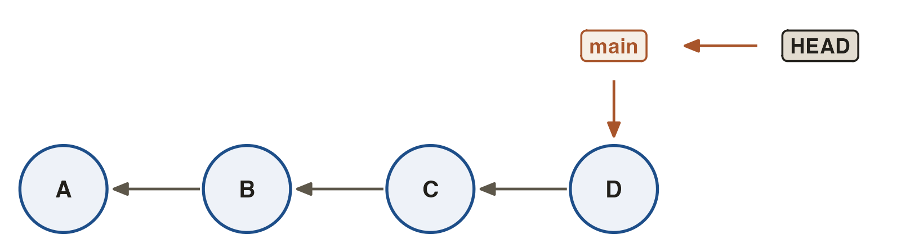
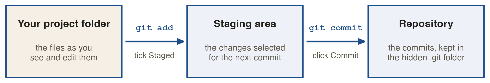
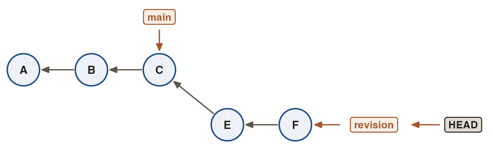
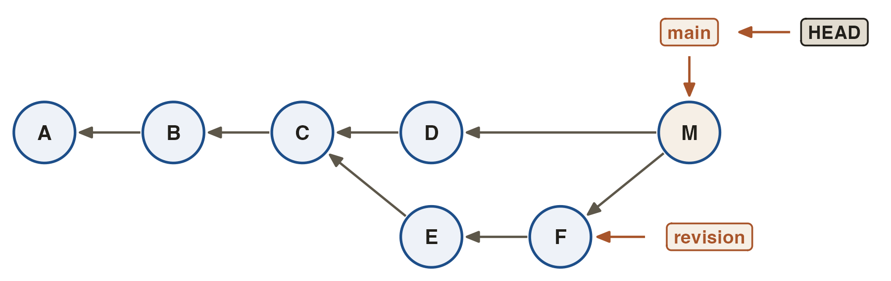
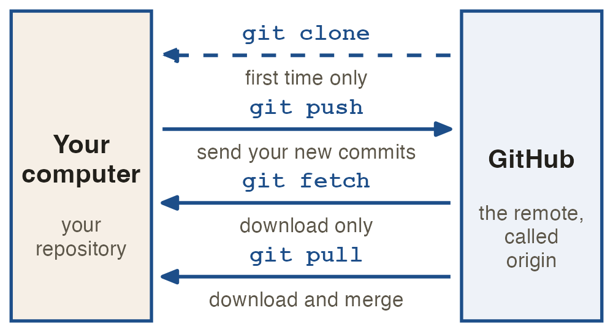
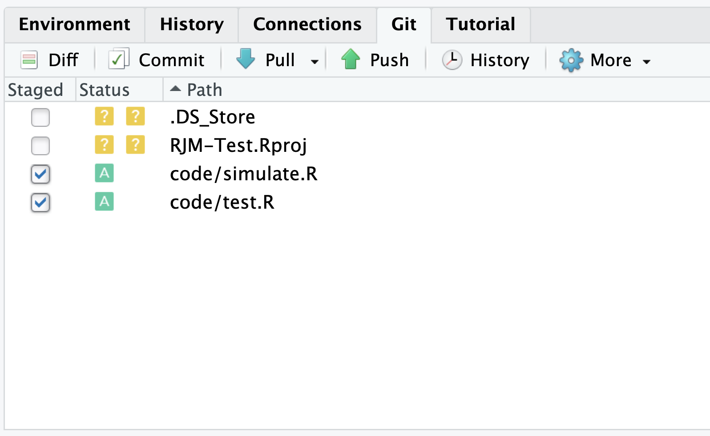

```{r}
#| label: setup
#| include: false
# A small practice repository, built in a temporary folder every time these
# slides are rendered. Every git output shown on the slides is real.
base <- file.path(tempdir(), "git-demo")
unlink(base, recursive = TRUE)
repo <- file.path(base, "corn-project")
dir.create(file.path(repo, "analysis"), recursive = TRUE)

# Fixed names and dates, so the commit identifiers are the same every render.
Sys.setenv(
  GIT_AUTHOR_NAME = "A Student", GIT_AUTHOR_EMAIL = "student@example.com",
  GIT_COMMITTER_NAME = "A Student", GIT_COMMITTER_EMAIL = "student@example.com",
  GIT_AUTHOR_DATE = "2027-01-20T10:00:00", GIT_COMMITTER_DATE = "2027-01-20T10:00:00"
)

# Run git in a folder and print the command and its output as a terminal does.
git_in <- function(dir, ..., show = TRUE) {
  args <- c(...)
  out <- suppressWarnings(system2(
    "git", c("-C", shQuote(dir), "-c", "commit.gpgsign=false", "-c", "color.ui=false", args),
    stdout = TRUE, stderr = TRUE
  ))
  out <- gsub(base, "", out, fixed = TRUE)
  if (show) cat(paste("$ git", paste(args, collapse = " ")), out, sep = "\n")
  invisible(out)
}
git <- function(...) git_in(repo, ...)
put <- function(path, lines) writeLines(lines, file.path(repo, path))

clean_lines <- function(cutoff) c(
  "Read the raw yields and drop fields with an impossible yield.",
  "",
  "```{r}",
  "corn <- readr::read_csv(here::here(\"data\", \"raw\", \"corn_yields.csv\"))",
  paste0("corn <- dplyr::filter(corn, Yield > ", cutoff, ")"),
  "```"
)

summary_lines <- function(title, ylab, debug = FALSE) c(
  "Draw yields of irrigated and non-irrigated fields.",
  "",
  "```{r}",
  "corn <- readRDS(here::here(\"data\", \"processed\", \"corn_clean.rds\"))",
  if (debug) "print(nrow(corn))  # debugging",
  "ggplot2::ggplot(corn, ggplot2::aes(x = factor(Irrigated), y = Yield)) +",
  "  ggplot2::geom_boxplot() +",
  "  ggplot2::labs(",
  paste0("    title = \"", title, "\","),
  "    x = \"Irrigated\",",
  paste0("    y = \"", ylab, "\""),
  "  )",
  "```"
)

put("README.md", c("# Corn project", "", "Corn yields in Nebraska counties, 2008."))
put("analysis/01-clean.qmd", clean_lines(0))
put("analysis/02-summary.qmd", summary_lines("Corn yield by irrigation", "Yield"))
git("init", "-q", "-b", "main", show = FALSE)
git("add", ".", show = FALSE)
git("commit", "-q", "-m", shQuote("Start the project"), show = FALSE)
```

# How this lecture works

<html><div style='float:left'></div><hr color='#EB811B' size=1px width=796px></html>

## What you will and will not learn today

::: {.panel-tabset}

### The plan

An AI assistant can run every git command there is, and get each one right. What it cannot do is:

+ decide which of your changes belong together
+ know why you made them
+ know which files must never leave your computer
+ know whether it is safe to send your work to GitHub, where others can see it

Those four are your job. So today is about:

1. **The concept**: what version control is for, and what each of its steps does (stage, commit, push, pull, branch, merge, pull request)
2. **Reading code**: recognising what a git command will do, and reading what git prints
3. **Asking AI**: what to tell the AI, and what it must not do on its own
4. **Checking**: what to look at before you let the AI commit or push

You will not learn to type git commands from memory.

### Directions

+ Getting a repository onto your computer (cloning) is in lecture 02-0. This lecture is about what to do with one.
+ To follow along on your own project you need git, a free GitHub account, and a few one-time settings. The **Before class** section of exercise 6-2 lists them, each with a check whose answer you know (for example, `git config --global pull.rebase` prints `false`). Do it before class; an AI assistant can help.
+ The git output on these slides comes from a small practice repository that is built in a temporary folder each time the slides are made. Every output is real. Where the code that produced an output is shown, `put()` writes a file into that repository and `git()` runs one git command in it; both are small functions written for these slides.

:::

# The concept

<html><div style='float:left'></div><hr color='#EB811B' size=1px width=796px></html>

## What version control is for

::: {.panel-tabset}

### The folder you already have

```text
analysis.qmd
analysis_v2.qmd
analysis_v2_new.qmd
analysis_final.qmd
analysis_final_USE_THIS.qmd
```

+ You do not know what is **different** between any two of them.
+ You do not know **why** any of them exists.
+ You do not know **which one produced the numbers in your paper**.
+ You cannot go back to a moment you did not think to save.

You have the files. What is missing is a record of what changed, when, and why.

### What you want to answer

+ "What did I change last Tuesday, and why?"
+ "Put the whole project back the way it was before I started the revision."
+ "Which version of the code produced the table in the submitted paper?"
+ "My coauthor changed the cleaning step this week. Which lines?"
+ "The AI edited six files. What exactly did it change?"

**Version control** is a record of a project's history that answers these. **Git** is the program that keeps that record, on your computer. **GitHub** is a website that keeps a copy of it, so others can see and add to it.

### Why a synced folder is not this

Dropbox, Google Drive and OneDrive keep old copies of each file. That is not the same:

+ **A change spans files.** Renaming a column changes three steps at once, for one reason. Git records that as one change. A synced folder records three unrelated file times.
+ **Nothing records why.** There is no place for the reason, and the reason is what you need later.
+ **You cannot go back to a moment.** You restore files one at a time and hope you found them all.

Keep a git repository on your computer's own disk, not inside a synced folder; sync programs and git can each change files the other is using. For a copy elsewhere, use GitHub.

:::

## Repository and commit

::: {.panel-tabset}

### A repository

A **repository** is your project folder plus its full history. Making a folder a repository adds one hidden folder, `.git`, where git keeps the history. Every other file stays an ordinary file you edit as usual.

+ One repository per research project, at the project root, next to the `.Rproj` file.
+ The history is on your disk. Git needs no internet connection; GitHub is optional.

### A commit

A **commit** is a stored copy of the whole project at one moment, with a message saying why. The history is the list of commits, each one pointing back to the one before it.

{width=60% fig-alt="Four commits, A to D, from left to right, each with an arrow pointing back to the one before it. A label main points to D, and a label HEAD points to main"}

`main` is the name of the line of commits; `HEAD` marks the one you are on (more on both under Branch and merge).

+ **Complete**: going back to a commit gives you the whole project as it was, not one old file among new ones.
+ **Permanent**: it stays in the history. Only the few commands under "Commands that can lose work" can remove it from a branch, and even then git keeps it for a while.
+ **It carries a reason**: the message.

### What a commit is not

+ **Not saving a file.** You save without thinking. You commit on purpose, when you have finished something that makes sense on its own, a few times a day.
+ **Not a backup.** A backup protects against losing your computer. A commit protects against losing track of what changed and why. Have both; GitHub gives you a copy of the history.
+ **Not only the changes.** A commit stores the whole project. The list of changed lines you see for a commit (git calls it a **diff**) is worked out by comparing it with the commit before.

:::

## Stage, then commit

{width=100% fig-alt="Three boxes from left to right: your project folder, staging area, repository. An arrow labelled git add, or tick Staged, leads from the first to the second; an arrow labelled git commit, or click Commit, leads from the second to the third"}

+ **Your project folder**: the files as you see and edit them, with every change you have made. Git's messages call this the **working directory**; that is not the same as R's working directory from 03-1.
+ **Staging** (git's word: `add`): choosing which of those changes go into the next commit.
+ **Committing**: storing the staged changes as one commit, with a message.

:::{.callout-note title="Why the middle step exists"}
A morning's work often holds several unrelated changes: a fix to the cleaning step, a half-finished figure, a line you added to find a bug. Staging lets you commit the fix alone, with its own message, and leave the rest for later. Without it, every commit would be "everything I touched since the last one".
:::

## What goes into one commit

This is your decision, not the AI's: it cannot know which changes belong together or why you made them.

::: {.panel-tabset}

### One change

+ **One thing.** You can describe it in one line without the word "and".
+ **Complete.** The project still renders afterwards, so every commit in the history is a state you could go back to.
+ **Small enough to read.** A diff of 900 lines will not be read, by you or anyone.

When to commit:

+ When you would be annoyed to lose the last hour.
+ **Before anything risky**: a large rewrite, a step that overwrites files, and **before you let an AI edit your project**. Afterwards, the diff shows exactly what it changed, and you can undo any of it.

### The message

```text
Drop fields with zero yield before averaging

NASS writes 0 for counties with no harvested acres. Including them
pulled the average irrigated yield down by 4 bu/ac.
```

+ **First line**: what the commit does, in under about 50 characters, written as an instruction ("Drop fields...", not "dropped" or "changes").
+ **Then a blank line and a few sentences**, if the reason is not obvious. Say **why**. What changed is already in the diff; why is only in your head, and you will forget it.

:::{.callout-important}
A message such as `update`, `fix` or `changes` tells a reader nothing. AI assistants write messages like "Update files" unless told the reason. Give it the reason.
:::

:::

## What stays out of the repository

Also your decision. Everything committed is kept for good, and anyone with a copy of the repository has all of it.

::: {.panel-tabset}

### In, out, and it depends

| | What | Why |
|---|---|---|
| **In** | `.qmd` and `.R` files, `README.md`, `.gitignore`, `renv.lock`, the `.Rproj` file | Written by you, small, text |
| **Never** | Passwords and API keys (often in a file called `.Renviron`), data under a data use agreement, data that identifies people | Permanent once committed, visible to anyone with a copy |
| **Usually out** | Rendered HTML and its `_files` folders, `data/processed/`, `results/` | Your steps rebuild them (06-1) |
| **Out** | `.Rhistory`, `.RData`, `.Rproj.user/`, `.DS_Store` | Files RStudio and macOS write for themselves |
| **Depends** | `data/raw/` | In if small and you may share it; out if large (GitHub refuses files over 100 MB) or restricted |

### `.gitignore`

A text file at the project root listing what git should ignore. Each line is a file name or a pattern; `*` stands for any characters, and a name ending in `/` means a folder.

```text
# files RStudio and macOS write
.Rhistory
.RData
.Rproj.user/
.DS_Store

# secrets
.Renviron

# rendered output, rebuilt by rendering
*.html
*_files/
```

:::{.callout-important}
`.gitignore` only affects files git is **not already tracking**. A file committed once stays in the history even if you add it to `.gitignore` later. Write `.gitignore` **before** the first commit.
:::

### A key that was committed

Deleting a password in a later commit does not remove it: the earlier commit still holds it, and anyone who copies the repository gets every commit.

If a key ever reaches GitHub, **replace the key** (make a new one, cancel the old one) at once. Do not try to erase it from the history.

:::

## Branch and merge

::: {.panel-tabset}

### A branch

A **branch** is a name that points at a commit and moves forward as you commit. Your main line of work is a branch called `main`. Making a new branch lets you work on a separate line of commits; `main` stays as it was.

{width=70% fig-alt="Commits A, B, C on a top row with main pointing to C. Commits E and F on a lower row, E pointing back to C. A label revision points to F, and HEAD points to revision"}

**Switching** to a branch changes the files in your folder to match that branch. `HEAD` in the figure means "the branch you are on".

### When research needs one

+ **A revision.** The paper is submitted. Work on a branch called `revision`, and `main` stays exactly what you submitted.
+ **An idea you doubt.** Try it on a branch. If it does not work, delete the branch, and nothing of it is left in `main`.
+ **An AI's larger change.** Let it work on a branch, read what it did, then decide whether to bring it into `main`.

For a project you work on alone, `main` and well-made commits are enough until one of these comes up.

### Merging

**Merging** brings the commits of one branch into another. On `main`, merge `revision`, and its commits become part of `main`.

{width=75% fig-alt="Commits A to D on the top row and E, F on a lower row branching from C. A merge commit M on the top row points back to both D and F. main points to M, HEAD points to main, and revision points to F"}

If the two branches changed different files, or different parts of a file, git combines them without asking. If both changed **the same lines**, git stops: that is a merge conflict, the next tab.

### Merge conflict

```{r}
#| label: conflict
git("switch", "-q", "-c", "units-in-labels", show = FALSE)
put("analysis/02-summary.qmd", summary_lines("Corn yield by irrigation", "Yield (bu/ac)"))
git("commit", "-q", "-am", shQuote("Give the units in the y-axis label"), show = FALSE)
git("switch", "-q", "main", show = FALSE)
put("analysis/02-summary.qmd", summary_lines("Corn yield by irrigation", "Corn yield"))
git("commit", "-q", "-am", shQuote("Name the crop in the y-axis label"), show = FALSE)
git("merge", "units-in-labels")
```

Both branches changed the same line of `analysis/02-summary.qmd`, the label of the y-axis. Git wrote both versions into the file, between marker lines:

```{r}
#| label: conflict-file
cat(readLines(file.path(repo, "analysis", "02-summary.qmd")), sep = "\n")
```

+ Between `<<<<<<<` and `=======`: the line on the branch you are on (`HEAD`, here `main`).
+ Between `=======` and `>>>>>>>`: the line on the branch you are merging in.

Which label is right is a question about what your readers need, not about text, so git leaves it to you. The fix: edit the file to the version you want, delete the three marker lines, then stage and commit. An AI can do the editing; the choice is yours.

```{r}
#| label: conflict-resolve
#| include: false
put("analysis/02-summary.qmd", summary_lines("Corn yield by irrigation", "Yield (bu/ac)"))
git("commit", "-q", "-am", shQuote("Keep the units in the y-axis label"), show = FALSE)
```

:::

## Push, pull, and GitHub

::: {.panel-tabset}

### A remote

A **remote** is a copy of your repository somewhere else, usually on GitHub. By convention it is called `origin`.

{width=60% fig-alt="Two boxes, your computer on the left and GitHub on the right, with four arrows between them: git clone (dashed, toward your computer), git push (toward GitHub), git fetch and git pull (toward your computer)"}

+ **Push**: send your new commits to the remote.
+ **Pull**: get the commits others have pushed, and merge them into yours. A pull can stop with a merge conflict, for the same reason and with the same fix as on the previous slide.
+ **Fetch**: get them without merging, to look first.

### Two things that can stop a pull

If a pull stops and git says it needs to know how to reconcile divergent branches, the one-time setting `git config --global pull.rebase false` is missing. It tells git to merge on a pull (the default this lecture assumes), not to rewrite your commits.

When a pull has to merge, git opens a text editor for the merge message. `git pull --no-edit` accepts git's standard message instead. Ask an AI agent for `--no-edit`: it cannot type into an editor, and would wait forever.

### Why push

+ **A copy off your computer**, history included.
+ **Your coauthors and advisor** see the same history and add to it.
+ **The paper.** Many journals ask for the code. A repository can be private while you work and made public when you publish; making it public shows its **entire history**, so read the history first.

### A pull request

A **pull request** is a proposal, made on GitHub, to merge one branch into another. Its page shows every changed line, and people can comment on single lines before anyone presses **Merge**.

+ With a coauthor: they push a branch, open a pull request, you read and comment, and one of you merges.
+ With an AI: the AI works on a branch and opens a pull request; you read the diff on the page, as carefully as a coauthor's, and merge only what you understand.
+ Alone: optional, but it gives you one page that lists everything a branch changed.

After a merge on GitHub, `main` on GitHub has a commit your computer does not. **Pull** to get it.

:::

## Going back

Each commit has an **identifier**, a code git gives it, such as `a3f9c21`; `git log --oneline` lists them. Going back always names either a file or a commit:

| You want | What git does | What is lost | When it is safe |
|---|---|---|---|
| A. Throw away the uncommitted changes to one file | `git restore <file>` puts the file back as it was at the last commit | Those uncommitted changes, for good: git never stored them | After reading `git diff <file>` and deciding you want none of it |
| B. Undo a change that is already committed | `git revert <identifier>` adds a new commit that reverses that commit | Nothing: both commits stay in the history | Always, even after a push, because it only adds |
| C. One file as it was at an earlier commit | `git restore --source <identifier> <file>` puts that version of the file in your folder, as an uncommitted change | Any uncommitted changes to that file | After reading `git diff <file>`; then commit it, with a message saying why |

+ A and C can lose work, and only work you never committed. That is the strongest reason to commit often.
+ B is the way to undo anything already on GitHub: the history shows both the change and its undoing. If later commits changed the same lines, B stops with a conflict, with the same fix as for a merge.
+ Undoing by rewriting the history (`reset`, `commit --amend`, `rebase`) also exists. It is in the table "Commands that can lose work", and it is never needed for the three cases above.

## A working day

| Step | What it is for | Who decides |
|---|---|---|
| 1. Pull | Start from the newest version, including your coauthors' work | Routine |
| 2. Work | Edit, render, read the HTML | You, or the AI |
| 3. Look at what changed | Find the debugging line, the file you did not mean to touch | **You** |
| 4. Stage and commit one change | One change, with a message saying why | **You**: what goes in, and the reason |
| 5. Push | A copy on GitHub, for you and others | **You**: after checking what is in it |

{width=45% fig-alt="RStudio's Git tab, with buttons Diff, Commit, Pull (blue arrow down), Push (green arrow up), History and More, above a list of files with Staged checkboxes"}

RStudio's **Git** tab has a button for each step. A commit made by clicking, by typing a command, or by asking an AI is the same commit.

# Reading git commands

<html><div style='float:left'></div><hr color='#EB811B' size=1px width=796px></html>

## How git commands are written

An AI that works with git runs commands in a terminal and shows them to you. Every git command follows the same pattern.

::: {.panel-tabset}

### The pattern

```text
git  verb  target  --option value
```

| Part | What it is | Required? |
|---|---|---|
| `git` | The program | Yes |
| `verb` | What to do: `status`, `add`, `commit`, `push`, ... | **Yes**, exactly one |
| `target` | Which files, branch or remote. Left out, it usually means "all" or "the current one" | Depends on the verb |
| `--option value` | Changes what the verb does: `-m "message"`, `--staged`, `--force` | No |

A real line that follows the pattern:

```text
git add analysis/01-clean.qmd
```

Stage the changes in `analysis/01-clean.qmd`, and only that file.

### The common verbs

The column that matters is the last one: what the command changes.

| Command | What it does | What it changes |
|---|---|---|
| `git status` | Lists changed, staged and untracked files | Nothing |
| `git diff` | Shows changed lines (`--staged`: the staged ones) | Nothing |
| `git log` | Lists commits | Nothing |
| `git add <files>` | Stages changes | Only what is staged |
| `git commit -m "<message>"` | Makes a commit from what is staged | Adds to the history |
| `git switch <branch>` | Moves to a branch (`-c`: makes a new one) | The files in your folder |
| `git merge <branch>` | Brings another branch's commits into this one | Adds to the history; can stop with a conflict |
| `git push` | Sends new commits to the remote | **The copy on GitHub** |
| `git pull` | Gets new commits from the remote and merges them | The history and your files |
| `git restore <file>` | Puts a file back as it was at the last commit | **Throws away uncommitted changes to it, for good** |
| `git revert <identifier>` | Adds a commit that reverses an earlier one | Adds to the history |

### Commands that can lose work

These are the commands to stop and read before they run:

| Command | What it does |
|---|---|
| `git restore <file>`, `git checkout -- <file>` | Throws away uncommitted changes to a file |
| `git reset --hard` | Throws away **all** uncommitted changes |
| `git push --force` | Replaces the history on GitHub with yours, deleting commits others pushed |
| `git commit --amend`, `git rebase` | Rewrites commits that may already be on GitHub |
| `git clean -fd` | Deletes every untracked file |

Committed work can almost always be recovered. Uncommitted work, once thrown away, cannot.

### Variations you will see

+ `git add .` or `git add -A`: stage **every** change in the folder, including files you did not mean to commit.
+ `git commit -am "<message>"`: stage every change to tracked files and commit, in one command.
+ `gh repo create`, `gh pr create`: commands of `gh`, GitHub's own program, for things that happen on GitHub (make a repository, open a pull request).
+ `git -C <folder> status`: run the command in another folder.
+ `git add . && git commit -m "..."`: `&&` runs the second command only if the first succeeded.

:::

## Reading what git prints

The practice repository, after the figure title in the summary step was changed and two new files appeared:

```{r}
#| label: status-setup
#| include: false
put("analysis/03-regression.qmd", c("Regression of yield on irrigation.", "", "```{r}", "```"))
put(".Renviron", "NASS_API_KEY=not-a-real-key-0000")
put("analysis/02-summary.qmd", summary_lines("Corn yield by irrigation, 2008", "Yield (bu/ac)"))
```

::: {.panel-tabset}

### git status

```{r}
#| label: status
git("status")
```

+ First line: the branch you are on.
+ "Changes not staged for commit": tracked files that changed. "modified" means edited.
+ "Untracked files": files git has never stored. `.Renviron` is here because there is no `.gitignore` yet, so `git add .` would commit the key in it.

### git diff

```{r}
#| label: diff
git("diff")
```

+ `--- a/` and `+++ b/`: the file, before and after.
+ A line starting with `-` was removed; a line starting with `+` was added; other lines are shown for context.
+ Here, one line: the figure title gained its year.

### git log

```{r}
#| label: log
git("log", "--oneline", "--graph", "--decorate")
```

+ One commit per line, newest first, each with the first 7 characters of its identifier (see Going back) and the first line of its message.
+ `*` marks a commit; the lines on the left show the two branches and where they were merged.
+ `(HEAD -> main)`: the commit you are on, and the branch you are on.

:::

# Asking AI

<html><div style='float:left'></div><hr color='#EB811B' size=1px width=796px></html>

## Working with AI on your own research

The way of working from lecture 02-1, "Working with AI on your own research" (the AI writes into a `.qmd` and renders it, and you read the HTML) gains three habits once the project has a history:

1. **Commit before the AI starts.** Then every change it makes shows up in `git diff`, and any of it can be undone.
2. **Read the diff after it finishes,** as well as the HTML. The HTML shows what the code produced; the diff shows every line it touched, including in files you did not ask about.
3. **Commit what you accept,** with a message saying why, and only then push.

:::{.callout-note}
Requests in this lecture ask the AI to run git, not to write R code into a `.qmd`, so they do not end with the closing instructions from 03-1. They end with the **git safety instructions**, under **Recommended requests**: show each command that changes anything before running it, and never run the commands that can lose work.
:::

## What to put in your request

The AI can see your files and run any command. What it cannot know:

1. **Which changes belong together**: name the files (or the change) for this commit.
2. **Why you made them**: give the reason, so the message can say it.
3. **What must stay out**: files with keys, restricted data, large files; or ask it to show you the list first.
4. **Where it goes**: which branch, and whether it may push at all.
5. **What it must not do**: the git safety instructions.

:::{.callout-tip title="Using a chat assistant?"}
It cannot run anything. It gives you commands to paste into RStudio's **Terminal** tab. Read each one against "How git commands are written" before you press Enter, and paste the output back if you are unsure what it means.
:::

## A weak request and a strong one

::: {.panel-tabset}

### Weak

```text
Commit and push my changes.
```

A typical reply runs:

```text
git add .
git commit -m "Update files"
git push
```

`git add .` stages every change, including `.Renviron` with its key and the unfinished `03-regression.qmd`. The message says nothing. The push sends all of it to GitHub before you have looked.

### Strong

```text
In my project, I added the year, 2008, to the figure title in
analysis/02-summary.qmd, because the figure will be shown next to
figures for other years. Commit only that file, with a message that
says so. Do not stage anything else; .Renviron must never be
committed. Show me git status and git diff --staged before you
commit. Do not push.

Before you run any command that changes my files, my history or GitHub,
show me the command, say in one plain-English sentence what it does,
and wait for me to say yes. Never run git push --force, git reset
--hard, git rebase, git commit --amend or git clean. After each
command, show me what git printed.
```

### What came back

The AI stages the one file and shows what is staged, before committing:

```{r}
#| label: staged
git("add", "analysis/02-summary.qmd", show = TRUE)
git("diff", "--staged")
git("status", "--short")
```

`git status --short` prints one line per file: `M ` (letter in the first column) means staged, `??` means untracked. One file is staged, with the one line you meant to change; `.Renviron` and `03-regression.qmd` are untracked and stay out. You say yes, and it commits:

```{r}
#| label: commit
git("commit", "-q", "-m", shQuote("Add the year to the figure title"), "-m",
    shQuote("The figure will be shown next to figures for other years."), show = FALSE)
git("log", "--oneline", "--decorate", "-1")
```

:::

# Checking before you let it commit or push

<html><div style='float:left'></div><hr color='#EB811B' size=1px width=796px></html>

## Checking: what to look at, and why

::: {.panel-tabset}

### The six checks

Run them before every commit and push the AI makes. You know each right answer before you look:

| | Ask the AI to show | Why | What only you know |
|---|---|---|---|
| 1 | `git status`: the branch | A commit on the wrong branch goes to the wrong line of work | which branch this belongs on |
| 2 | `git status`: the staged files | `git add .` takes everything | which files you meant to change |
| 3 | `git diff --staged` | Every line that will be committed, including ones you did not ask for | what the change should be |
| 4 | the staged files, for keys, restricted data and large files | Once pushed, they are public to anyone with access, for good | which files are secret or restricted |
| 5 | the commit message | It is the only record of why | the reason |
| 6 | `git remote -v`, and the push command itself | Pushing to the wrong repository, or with `--force` | where the project lives |

### Asking for them

```text
Before you commit, show me: the branch, the list of staged files,
and git diff --staged. I expect only <the files you changed> on branch
<branch name>, and no .Renviron or data files.

Before you run any command that changes my files, my history or GitHub,
show me the command, say in one plain-English sentence what it does,
and wait for me to say yes. Never run git push --force, git reset
--hard, git rebase, git commit --amend or git clean. After each
command, show me what git printed.
```

### Reading the result

The weak request's `git add .`, run on the practice repository, with the check printed:

```{r}
#| label: chk-staged
#| code-fold: true
#| code-summary: "Code that ran the check"
#| echo: true
put("analysis/02-summary.qmd", summary_lines("Corn yield by irrigation, 2008", "Yield (bu/ac)", debug = TRUE))
invisible(git("add", ".", show = FALSE))
staged <- git("diff", "--staged", "--name-only", show = FALSE)
branch <- git("branch", "--show-current", show = FALSE)
cat(
  paste("branch: expected main, got", branch),
  paste("staged files: expected 1, got", length(staged)),
  paste("staged files:", paste(staged, collapse = ", ")),
  paste(".Renviron staged: expected FALSE, got", ".Renviron" %in% staged),
  sep = "\n"
)
git("diff", "--staged", "--", "analysis/02-summary.qmd")
invisible(git("reset", "-q", show = FALSE))
```

The branch is right; the other two checks fail. Three files are staged instead of one, and one of them is the key. The staged diff of `02-summary.qmd` shows a second problem: the only line it adds is a debugging line, which nobody meant to commit. Nothing is committed yet, so nothing is lost: unstage (`git restore --staged`), add a `.gitignore`, and stage only what you meant.

:::

## What the AI may run on its own

One question decides it: **could this command lose work that git has not stored, or change something other people already have?**

::: {.panel-tabset}

### Read-only: no approval needed

+ `status`, `diff`, `log`, `show`: "what changed since Tuesday?", "what is this conflict about?"
+ Drafting a commit message from the diff, or the lines of a `.gitignore`, as text for you to read

### Say yes after reading the command

+ `add` and `commit`: once you have checked what is staged
+ `switch`, and making a branch: commit first if there are uncommitted changes
+ `merge` and `pull`: they change your files; commit first, so you can see what changed
+ `revert`: adds a commit that undoes another; safe even after a push
+ `restore`: only after reading `git diff` for that file, because it throws away its uncommitted changes
+ `push`: after the six checks
+ `gh repo create` and anything else that makes something on GitHub: check whether it is **private**

### Never

+ `reset --hard`, `clean`: throw away uncommitted work, in every file at once
+ `push --force`, `rebase`, `commit --amend` on pushed commits: rewrite history your coauthors already have

If an AI suggests one of these to "fix" an error, stop and ask it what the error means first. A refused push, for example, usually means someone else pushed first: the fix is `git pull --no-edit`, then push again.

:::

## Your turn: read the AI's commands

A student asked an AI to "save my work to GitHub, it says the push failed", and it ran:

```text
git add -A
git commit -m "update"
git push --force
```

::: {.panel-tabset}

### Questions

A. In plain words, what does each command do?

B. Why did the first push probably fail?

C. Which command can delete someone else's work, and whose?

D. What else might have gone into the commit without the student knowing?

E. Rewrite the request so the AI could not do this.

### Answers

A. Stages every change in the folder; commits it with the message "update"; replaces the history on GitHub with the student's own.

B. Someone (a coauthor, or the student from another computer, or a pull request merged on GitHub) pushed commits the student did not have. Git refuses a push that would drop them.

C. `git push --force`. It deletes from GitHub the commits the student did not have, which are someone else's work.

D. Anything in the folder that is not in `.gitignore`: a `.Renviron` with a key, rendered HTML, data files, half-finished steps.

E. Say which files to commit and why, ask to see `git status` and `git diff --staged` first, say "if the push is refused, pull with git pull --no-edit and show me what came in; never use --force", and end with the git safety instructions.

:::

# Recommended requests

<html><div style='float:left'></div><hr color='#EB811B' size=1px width=796px></html>

## Requests you can copy

Copy one, then replace every `<...>` with what **you** know. Every request that has the AI run a command that changes something ends with the git safety instructions.

::: {.panel-tabset}

### Git safety instructions

The lines that end every request in which the AI may run a command that changes your files, your history or GitHub. Requests that only read (status, diff, log) may leave them out.

```text
Before you run any command that changes my files, my history or GitHub,
show me the command, say in one plain-English sentence what it does,
and wait for me to say yes. Never run git push --force, git reset
--hard, git rebase, git commit --amend or git clean. After each
command, show me what git printed.
```

A chat assistant cannot run commands: it gives them to you to run in the Terminal tab. Then these lines remind it to explain each one, and you are the one who says yes by pressing Enter.

### Start a repository

```text
Make my project folder <project folder> a git repository, with main
as the branch. Before the first commit, write a .gitignore that leaves
out <files and folders to leave out>. Then show me git status, so I can
check that none of <files that must never be committed> is listed.
Commit with the message "Start the project". Do not push.

Before you run any command that changes my files, my history or GitHub,
show me the command, say in one plain-English sentence what it does,
and wait for me to say yes. Never run git push --force, git reset
--hard, git rebase, git commit --amend or git clean. After each
command, show me what git printed.
```

### Commit one change

```text
I changed <what you changed, in which files>, because <why>. Commit
only <the files for this change>, with a message whose first line says
what the change does and whose second paragraph says why. Show me
git status and git diff --staged before you commit.

Before you run any command that changes my files, my history or GitHub,
show me the command, say in one plain-English sentence what it does,
and wait for me to say yes. Never run git push --force, git reset
--hard, git rebase, git commit --amend or git clean. After each
command, show me what git printed.
```

### Push

```text
Push my commits on <branch name> to GitHub. First show me git remote -v,
the commits that are not yet on GitHub (git log origin/<branch name>..HEAD
--oneline), and the files they change. If the push is refused, do not
force it: pull with git pull --no-edit, show me what came in, and wait.

Before you run any command that changes my files, my history or GitHub,
show me the command, say in one plain-English sentence what it does,
and wait for me to say yes. Never run git push --force, git reset
--hard, git rebase, git commit --amend or git clean. After each
command, show me what git printed.
```

### Work on a branch

```text
Make a branch called <branch name> and switch to it. I want to try
<the change you are unsure about>. Commit there as you go. When I say
so, show me git diff main...<branch name> (three dots: only what
changed on the branch since it split from main). Then do only what I
choose: merge it into main (git merge --no-edit), or push the branch
to GitHub and open a pull request into main, with a title that says
what the branch does and a description of why, and give me the link.
Never merge a pull request yourself.

Before you run any command that changes my files, my history or GitHub,
show me the command, say in one plain-English sentence what it does,
and wait for me to say yes. Never run git push --force, git reset
--hard, git rebase, git commit --amend or git clean. After each
command, show me what git printed.
```

### Merge conflict

```text
Merging <the branch being merged in> into <the branch you are on>
stopped with a conflict.
For each conflicted file, show me the two versions of each conflicting
part and explain in one plain-English sentence how they differ. Do not
choose for me. When I tell you which to keep, edit the file, show me
the result, and commit it.

Before you run any command that changes my files, my history or GitHub,
show me the command, say in one plain-English sentence what it does,
and wait for me to say yes. Never run git push --force, git reset
--hard, git rebase, git commit --amend or git clean. After each
command, show me what git printed.
```

### Undo a change

```text
I want to undo <the uncommitted changes to a file, or the commit whose
message is ...>. First show me git status and exactly what will change,
and say in one plain-English sentence what will be lost. If it is
already committed, undo it by adding a new commit; never rewrite the
history.

Before you run any command that changes my files, my history or GitHub,
show me the command, say in one plain-English sentence what it does,
and wait for me to say yes. Never run git push --force, git reset
--hard, git rebase, git commit --amend or git clean. After each
command, show me what git printed.
```

### Explain commands

```text
Explain these git commands to me. For each, write one plain-English
sentence saying what it does, and whether it changes my files, my
history, GitHub, or nothing. Then list any that could lose work.

<paste the commands here>
```

:::

# Summary

<html><div style='float:left'></div><hr color='#EB811B' size=1px width=796px></html>

## What you must understand, and what the AI can run

| You need to understand | The AI can run |
|---|---|
| What a commit is: the whole project, at one moment, with a reason | `git commit` |
| Which changes make one commit, and why you made them | `git add`, and a first draft of the message |
| Which files must never be committed | The `.gitignore` |
| What a branch and a merge are for, and which side of a conflict is right | `git switch`, `git merge`, the edit that resolves it |
| What push, pull and a pull request do, and who sees what you push | `git push`, `git pull`, `gh pr create` |
| Which commands can lose work, and how to go back safely | None of them without your yes |

**Every change the AI makes:** commit before it starts, read `git status` and `git diff --staged` before it commits, and check the branch, the files and the remote before it pushes.
